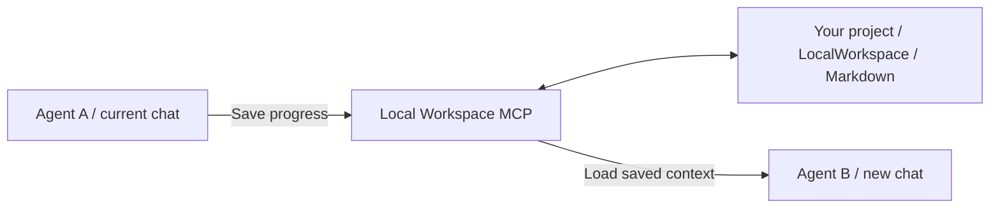

# Local Workspace MCP

**Carry your task across chats and AI coding agents.**

[English](README.md) · [简体中文](README.zh-CN.md)

Local Workspace MCP is a local [Model Context Protocol](https://modelcontextprotocol.io/) server that saves task goals, progress, decisions, next steps and reusable knowledge as **readable Markdown inside your project**. A new chat or another compatible agent can load that saved context and continue the work.

Built with **Java 17 · Spring Boot · Spring AI · MCP over STDIO**. The server needs no database, model API key or inference service.

[Quick start](#quick-start) · [Handoff example](#a-task-handoff) · [MCP tools](#mcp-tools) · [FAQ](#faq)

## Why use it?

A coding task can outlast a single chat. Its context includes the requirements you agreed on, the approaches you ruled out, the tests you ran and the next step you intended to take.

Local Workspace gives that task a place in the project:

| When you… | The next agent can load… |
| --- | --- |
| Open a new chat for unfinished work | The saved goal, constraints, progress and next steps |
| Switch to another MCP client | The same task files through its MCP connection |
| Return to a project after a break | The latest status, handoff notes and decision reasons |
| Reuse a solution in another task | Project knowledge linked to tasks and tags |

**The agent calls the tools to save and load.** Only saved information carries over; the server does not capture private chat history or force a client to use it.

## A task handoff

Imagine you are implementing login and refresh tokens. Before switching chats, Agent A saves:

| Saved item | Example |
| --- | --- |
| Goal | Add login and refresh-token support |
| Constraint | Preserve the existing authentication API |
| Progress | Login endpoint and its tests are complete |
| Next step | Implement token rotation and test expired tokens |
| Decision and reason | Store revocable tokens in Redis to support logout |

In the new chat, ask Agent B:

> Use the Local Workspace MCP to find the authentication task and load its context. Tell me the saved next step, check the current code and tests, then continue.

The expected workflow is:



To demonstrate this workflow with your own project, follow the [demo guide](docs/github-listing.md#demo).

## What you get

- **Task state in your project.** Separate files for the task brief, current status and latest handoff; shared knowledge lives alongside them.
- **A reusable MCP connection.** AUTO mode resolves each call from client Roots or an explicit `projectRoot`; you do not change the server configuration for each project.
- **Guidance for agents.** Initialization can add a managed entry to `AGENTS.md`, `CLAUDE.md`, or both, while preserving surrounding rules.
- **Revision checks.** A stale write returns `REVISION_CONFLICT` so the agent can reload and merge, including after a manual edit.
- **History on demand.** Saving a handoff, or explicitly requesting a checkpoint, archives the previous task documents. Old snapshots stay out of the default context.
- **Bounded context loading.** Choose documents and knowledge entries within a configurable character budget. Knowledge search uses text and tags.

## Quick start

### 1. Build the server

Requirements: **JDK 17** and **Maven 3.6.3+**. From the root of this repository, run:

```sh
mvn -B verify
```

This builds `target/local-workspace-mcp-0.1.0.jar` and runs unit and integration tests, including tests that launch the JAR over STDIO. If you only need to build, use `mvn -B -DskipTests package`.

The current verified platform is **Windows with JDK 17**.

### 2. Connect your agent

Use a client that supports **local STDIO MCP servers**. For clients accepting the `mcpServers` format:

```json
{
  "mcpServers": {
    "local-workspace": {
      "command": "java",
      "args": [
        "-Dfile.encoding=UTF-8",
        "-jar",
        "C:/path/to/Local-Workspace/target/local-workspace-mcp-0.1.0.jar"
      ]
    }
  }
}
```

**Replace the JAR path with its actual absolute path**; the example uses Windows path syntax. If your client cannot find `java`, use the absolute path to your JDK 17 executable. The JAR installation directory and the project whose tasks you save can be different directories.

The client starts this process for you. There is no HTTP URL or port to configure. Starting the JAR manually in a terminal leaves it waiting for STDIN; that is expected.

<details>
<summary>Codex configuration</summary>

Merge this into your Codex configuration, normally `~/.codex/config.toml`, and replace the JAR path:

```toml
[mcp_servers.local_workspace]
command = "java"
args = [
  "-Dfile.encoding=UTF-8",
  "-jar",
  "C:/path/to/Local-Workspace/target/local-workspace-mcp-0.1.0.jar"
]
startup_timeout_sec = 30
tool_timeout_sec = 60
```

Configuration fields follow the [official OpenAI MCP documentation](https://learn.chatgpt.com/docs/extend/mcp?surface=cli). Ready-to-edit files: [Codex TOML](examples/codex-config.toml) · [generic JSON](examples/mcp-stdio.json).

</details>

### 3. Initialize a project and start a task

Open the project you want to work on and ask your agent:

> Use the Local Workspace MCP to check the current project with workspace_status and initialize it if needed. Create a task for implementing login and refresh tokens; save the goal, constraints, plan, acceptance criteria and next steps. If the project cannot be selected automatically, pass the absolute project directory from your own workspace as the top-level projectRoot. Keep the resolved path on subsequent calls. Read the returned agent guide and save progress at meaningful milestones.

On first use, `workspace_init` creates the workspace and installs an `AGENTS.md` entry by default. It does not create task documents until `task_create` is called. Both new and existing projects are supported.

If your client uses `CLAUDE.md`, ask for `workspace_init` with `guidanceTarget: "claude"` or `"both"`. Other options are `"agents"` and `"none"`.

### 4. Save before leaving; load when returning

Before switching chats or clients:

> Update the task status with completed work, blockers, actual verification results and a concrete next step. Save a handoff with key decisions and their reasons. Save reusable project knowledge if there is any.

In the next chat or client:

> Use the Local Workspace MCP to list tasks in this project, find the matching task and load its context. Check STATUS.md and the actual project files before continuing.

The next client must connect to the same project files. For a different machine, transfer or synchronize the workspace files first.

## Files you own

```text
your-project/
├── AGENTS.md                         # Managed entry; surrounding rules preserved
└── LocalWorkspace/
    ├── workspace.json                # Workspace metadata
    ├── AGENT_GUIDE.md                # Agent workflow instructions
    ├── tasks/
    │   └── task-<UUID>/
    │       ├── task.md               # Goal, scope, constraints, plan, acceptance criteria
    │       ├── STATUS.md             # Progress, blockers, next steps, verification
    │       ├── handoff.md            # Summary, decisions, reasons, cautions
    │       └── archive/
    │           └── checkpoint-<time>-<UUID>/
    │               ├── checkpoint.json
    │               ├── task.md
    │               ├── STATUS.md
    │               └── handoff.md
    └── knowledge/
        └── knowledge-<UUID>.md       # Reusable knowledge with tags and task links
```

Task and knowledge documents contain service-managed YAML metadata and readable Markdown. Existing root-level `task.md` files stay untouched. When `AGENTS.override.md` already exists, the managed agent entry goes there instead of `AGENTS.md`.

Files can be inspected, backed up or versioned with your project. Manual task edits change the revision, so agents must reload before writing.

## MCP tools

| Tool | Purpose |
| --- | --- |
| `workspace_status` | Check project selection, initialization and guidance |
| `workspace_init` | Initialize the workspace and install the selected guide entry |
| `task_create` | Create a task with a brief and explicit next steps |
| `task_list` | Find tasks by title, tags and state |
| `context_load` | Load selected task documents and knowledge, with a character budget |
| `task_update` | Replace the task brief or status using the latest revision |
| `handoff_save` | Save the latest handoff and archive the previous task documents |
| `history_read` | List or read historical checkpoints |
| `knowledge_save` | Create or update reusable project knowledge |
| `knowledge_search` | Search knowledge by text, tags and task |

Every tool accepts an optional **top-level** `projectRoot`. Request-model tools use `{"request": {...}, "projectRoot": "..."}`; `handoff_save` takes its business fields at the top level.

The default context includes the guide, task brief, status and handoff. Knowledge is loaded by selected IDs; history is read separately. `STATUS.md` is the source for next steps, and the service flags stale handoff notes.

## FAQ

**Will every agent use it automatically?**

The server provides tools, workflow instructions and optional rule-file entries. Whether an agent follows them depends on its client and behavior. Give it an explicit instruction on first use and verify that progress was saved before switching.

**Does it save the whole conversation?**

It saves the task state and knowledge that the agent submits. It does not import private chat logs or reconstruct unsaved conversation history.

**Does it reduce token usage?**

Tool descriptions, calls and loaded documents use context. Selecting concise task state can limit what gets reloaded, but there is no measured token-saving guarantee. The default read budget is 24,000 Unicode code points, not tokens; the server does not call a model to summarize.

**What if project selection fails?**

For `PROJECT_REQUIRED` or `PROJECT_AMBIGUOUS`, the agent should pass a known absolute project directory from its own workspace. `ROOTS_UNAVAILABLE` means the client's Roots query failed or was incomplete and must be fixed first. A supplied path does not bypass nonempty client Roots. For a fixed project, add `--local-workspace.project-root=C:/work/your-project` to the startup arguments. Omit that argument entirely to use AUTO.

**Can I restore a checkpoint?**

`history_read` lets an agent inspect old documents; it does not overwrite the current task. Handoffs and explicit checkpoints archive the **pre-write** state. History is not deleted automatically.

**What happens with concurrent edits?**

Writes require the latest revision, and cooperating MCP processes use a project lock. Stale updates are rejected. Individual files are replaced atomically; this is not a multi-file transaction or a multi-user permission system.

## Development and feedback

The code separates project resolution, workspace initialization, tasks, history, knowledge, context budgets, storage and MCP adapters. See [source packages](src/main/java/dev/localworkspace) and run `mvn -B verify` before proposing behavioral changes.

Report bugs or discuss improvements through repository Issues. A useful report includes the client, Java version, operating system, tool name and a minimal example with private project content removed. Client compatibility reports and documentation improvements are welcome.

More documentation: [中文技术参考 / advanced reference](docs/reference.zh-CN.md) · [designs](docs/superpowers/specs) · [implementation plans](docs/superpowers/plans) · [verification and review](docs/superpowers/reviews/2026-10-19-automatic-project-resolution-review.md).
