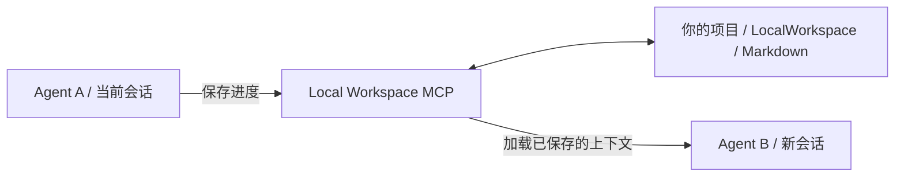

# Local Workspace MCP

**换个会话、换个 Agent，接着做同一个任务。**

[English](README.md) · [简体中文](README.zh-CN.md)

Local Workspace MCP 是一个本地 [Model Context Protocol](https://modelcontextprotocol.io/) 服务。它把任务目标、进度、决策、下一步和可复用知识保存为**项目里的 Markdown 文件**，让新会话或另一个兼容的 Agent 读取已保存的上下文，继续工作。

基于 **Java 17 · Spring Boot · Spring AI · MCP STDIO**。服务本身无需数据库、模型 API Key 或推理服务。

[快速开始](#快速开始) · [交接示例](#一次任务交接) · [MCP 工具](#mcp-工具) · [常见问题](#常见问题) · [技术参考](docs/reference.zh-CN.md)

## 它解决什么问题？

一个开发任务可能跨越很多次聊天。除了代码，你还需要记住：需求是怎么约定的、为什么选择这个方案、哪些测试已经跑过、下一步准备做什么。

Local Workspace 把这些信息放回项目里：

| 当你…… | 接手的 Agent 可以读取…… |
| --- | --- |
| 为未完成的任务开一个新会话 | 已保存的目标、约束、进度和下一步 |
| 换用另一个 MCP 客户端 | 通过 MCP 读取同一项目的任务文件 |
| 隔了一段时间回到项目 | 最新状态、交接记录和决策原因 |
| 在新任务里复用已有经验 | 带标签、关联任务的项目知识 |

**保存和读取由 Agent 调用工具完成。** 能带到下一次会话的是已经保存的信息；服务不会自动抓取私有聊天，也无法强制客户端使用它。

## 一次任务交接

假设你正在实现登录和刷新令牌。切换会话前，Agent A 保存了：

| 信息 | 示例 |
| --- | --- |
| 目标 | 实现登录和刷新令牌功能 |
| 约束 | 保持已有认证 API 兼容 |
| 当前进度 | 登录接口和对应测试已完成 |
| 下一步 | 实现令牌轮换，补充过期令牌测试 |
| 决策与原因 | 用 Redis 保存可撤销令牌，以支持退出登录 |

在新会话里，对 Agent B 说：

> 使用 Local Workspace MCP 找到认证任务并加载上下文。先告诉我保存的下一步，核对当前代码和测试，再继续实现。

交接流程如下：



在自己的测试项目中演示这一流程，可参考[演示脚本](docs/github-listing.md#demo)。

## 已有功能

- **任务状态保存在项目中。** 任务说明、当前状态、最新交接分别存放，共享知识独立管理。
- **一个连接配置用于多个项目。** AUTO 模式每次根据客户端 Roots 或明确的 `projectRoot` 定位，无需逐项目修改启动配置。
- **为 Agent 安装指南入口。** 可写入 `AGENTS.md`、`CLAUDE.md` 或两者的受管区块，保留区块外的已有规则。
- **修订号防止陈旧覆盖。** 写入前检查 revision；其他 Agent 或手动编辑改变内容后，返回 `REVISION_CONFLICT`，要求重读、合并。
- **按需查历史。** 保存交接或明确建立检查点时，归档修改前的任务文档；默认上下文不加载历史。
- **控制读取范围。** 按文档、知识 ID 和字符预算加载；知识支持文本与标签检索。

## 快速开始

### 1. 构建服务

需要 **JDK 17** 和 **Maven 3.6.3+**。在本仓库根目录执行：

```sh
mvn -B verify
```

生成 `target/local-workspace-mcp-0.1.0.jar`，同时运行单元测试和集成测试，包括启动 JAR 的 STDIO 验收。只构建产物可使用 `mvn -B -DskipTests package`。

当前已验证的平台是 **Windows + JDK 17**。

### 2. 接入 Agent

使用支持**本地 STDIO MCP** 的客户端。采用 `mcpServers` 格式的软件可以配置：

```json
{
  "mcpServers": {
    "local-workspace": {
      "command": "java",
      "args": [
        "-Dfile.encoding=UTF-8",
        "-jar",
        "C:/path/to/Local-Workspace/target/local-workspace-mcp-0.1.0.jar"
      ]
    }
  }
}
```

**把 JAR 路径改成你实际构建产物的绝对路径**，上面使用 Windows 路径格式。如果客户端找不到 `java`，将 command 改为 JDK 17 中 Java 可执行文件的绝对路径。JAR 安装目录与需要记录任务的业务项目可以是不同目录。

客户端会启动这个进程，无需另外配置 HTTP 地址或端口。在终端直接运行 JAR 后等待标准输入，是正常行为。

<details>
<summary>Codex 配置</summary>

合并到自己的 Codex 配置中，默认位置为 `~/.codex/config.toml`，并替换 JAR 路径：

```toml
[mcp_servers.local_workspace]
command = "java"
args = [
  "-Dfile.encoding=UTF-8",
  "-jar",
  "C:/path/to/Local-Workspace/target/local-workspace-mcp-0.1.0.jar"
]
startup_timeout_sec = 30
tool_timeout_sec = 60
```

字段格式参考 [OpenAI 官方 MCP 文档](https://learn.chatgpt.com/docs/extend/mcp?surface=cli)。可直接修改的示例文件：[Codex TOML](examples/codex-config.toml) · [通用 JSON](examples/mcp-stdio.json)。

</details>

### 3. 初始化项目并开始任务

打开你要开发的项目，对 Agent 说：

> 使用 Local Workspace MCP，通过 workspace_status 检查当前项目，未初始化时先初始化。为“实现登录和刷新令牌”创建任务，保存目标、约束、计划、验收标准和下一步。如果无法自动定位项目，从你自身工作环境确定项目绝对路径，作为顶层 projectRoot 传入；后续调用继续携带返回的真实路径。阅读返回的指南，在阶段完成时保存进度。

`workspace_init` 默认创建工作区并安装 `AGENTS.md` 入口；调用 `task_create` 后才生成任务文档。新项目、已经开发了一半的项目都可以使用。

如果客户端读取 `CLAUDE.md`，让 Agent 调用 `workspace_init` 时设置 `guidanceTarget: "claude"` 或 `"both"`。另有 `"agents"`、`"none"` 选项。

### 4. 离开前保存，回来后加载

准备换会话或换软件时：

> 更新任务状态，保存已完成事项、阻塞、实际验证结果和明确的下一步。保存交接，写清关键决策及原因；如有可复用的项目知识，一并保存。

新会话或新客户端中：

> 使用 Local Workspace MCP 列出当前项目的任务，找到对应任务并加载上下文。核对 STATUS.md 与实际项目文件后，继续工作。

新客户端需要连接同一份项目文件。换电脑时，先转移或同步工作区文件。

## 文件放在哪里？

```text
your-project/
├── AGENTS.md                         # 受管入口；保留其他已有规则
└── LocalWorkspace/
    ├── workspace.json                # 工作区元数据
    ├── AGENT_GUIDE.md                # Agent 操作指南
    ├── tasks/
    │   └── task-<UUID>/
    │       ├── task.md               # 目标、范围、约束、计划、验收标准
    │       ├── STATUS.md             # 进度、阻塞、下一步、验证结果
    │       ├── handoff.md            # 交接摘要、决策、原因、注意事项
    │       └── archive/
    │           └── checkpoint-<时间>-<UUID>/
    │               ├── checkpoint.json
    │               ├── task.md
    │               ├── STATUS.md
    │               └── handoff.md
    └── knowledge/
        └── knowledge-<UUID>.md       # 带标签、关联任务的可复用知识
```

任务和知识文档包含服务管理的 YAML 元数据和可读 Markdown 正文。项目根目录已有的 `task.md` 保持原样；已有 `AGENTS.override.md` 时，Agent 入口写入该文件。

你可以查看文件、备份或按项目策略纳入版本控制。手动修改任务文档会改变修订号，Agent 再写入前需要重新读取。

## MCP 工具

| 工具 | 用处 |
| --- | --- |
| `workspace_status` | 检查项目定位、初始化状态和指南入口 |
| `workspace_init` | 初始化工作区，安装所选指南入口 |
| `task_create` | 创建任务说明和明确的下一步 |
| `task_list` | 按标题、标签和状态查找任务 |
| `context_load` | 在字符预算内加载所选任务文档和知识 |
| `task_update` | 携带最新修订号，更新任务说明或状态 |
| `handoff_save` | 保存最新交接，归档修改前的任务文档 |
| `history_read` | 列出或读取历史检查点 |
| `knowledge_save` | 创建或更新可复用的项目知识 |
| `knowledge_search` | 按文本、标签、任务检索知识 |

所有工具都有可选的**顶层** `projectRoot`。使用请求模型的工具格式为 `{"request": {...}, "projectRoot": "..."}`；`handoff_save` 的业务参数直接放在顶层。

默认上下文包含指南、任务说明、状态和交接。知识按 ID 选择加载，历史单独读取。下一步以 `STATUS.md` 为准；交接记录陈旧时会收到提示。

## 常见问题

**Agent 会自动使用吗？**

服务提供工具、操作指南和可选的规则入口；是否遵循取决于客户端和 Agent 行为。建议首次明确要求使用，切换前确认阶段进度已保存。

**整段聊天都会保存吗？**

保存的是 Agent 提交的任务状态和知识。不会导入私有聊天，也无法恢复未保存的对话历史。

**能节省 Token 吗？**

工具描述、调用和读取的文档都会占用上下文。精简任务状态、选择需要的文档可以控制重复加载范围，但目前没有节省 Token 的实测承诺。默认读取预算为 24,000 Unicode code points，不等于 Token 数；服务本身不调用模型总结。

**不能自动定位项目怎么办？**

遇到 `PROJECT_REQUIRED` 或 `PROJECT_AMBIGUOUS`，Agent 应从自己的工作环境确定绝对路径并传入。`ROOTS_UNAVAILABLE` 表示客户端 Roots 查询失败或不完整，需要先修复；显式路径不能绕过非空 Roots 的目录范围。只需固定一个项目时，可在启动参数添加 `--local-workspace.project-root=C:/work/your-project`；使用 AUTO 时完全省略该参数。

**历史快照能直接回滚吗？**

`history_read` 供 Agent 查看旧文档，不会覆盖当前任务。保存交接或明确建立检查点时，归档的是**修改前**的状态。历史不会自动删除。

**多个 Agent 同时修改怎么办？**

写入要求最新修订号；合作的 MCP 进程使用项目锁，陈旧修改会被拒绝。文件逐个原子替换，不提供多文件事务或多用户权限系统。

## 开发与反馈

代码按项目定位、工作区初始化、任务、历史、知识、上下文预算、存储和 MCP 适配分层，见[源码目录](src/main/java/dev/localworkspace)。修改行为前请运行 `mvn -B verify`。

欢迎通过仓库 Issues 反馈问题或讨论改进。问题报告请附客户端、Java 版本、操作系统、工具名称，以及去除项目私密内容的最小示例；也欢迎补充客户端兼容性实测和文档改进。

进一步阅读：[技术参考](docs/reference.zh-CN.md) · [设计文档](docs/superpowers/specs) · [实施计划](docs/superpowers/plans) · [验收与审查](docs/superpowers/reviews/2026-10-19-automatic-project-resolution-review.md)。
